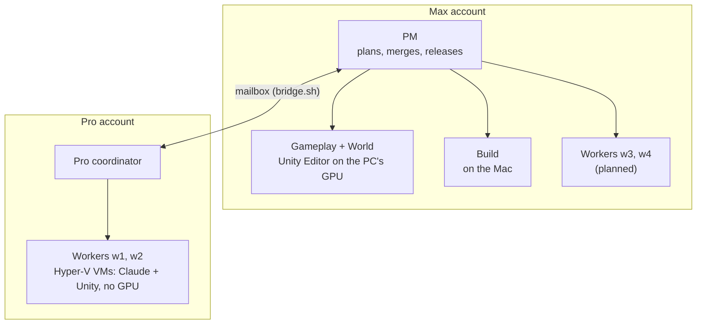

# How the agents are set up

Several Claude Code sessions, on two Claude accounts, build this game at once.
They share one PC, a Mac and a set of Hyper-V worker VMs. This page is the
overview; the details are in COORDINATION.md (lanes and rules) and
[tools/workers/README.md](../tools/workers/README.md) (the VMs).

Arrows are who hands work to whom. Every session works on its own branch and
pushes it to GitHub, and the PM or the Pro coordinator merges into `dev`.
Andrew reaches any session from his phone with Remote Control.

## Who does what

| Part | Account | Where | Does |
|---|---|---|---|
| **PM** | Max | PC, Claude app | Lanes, merge order, releases and notes, reports to Andrew. Writes no game code. |
| **Gameplay, World** | Max | PC, with the host Unity Editor | Anything that needs a picture or the GPU: views, effects, probes, screenshots, clips, performance runs. |
| **Build** | Max | Mac | macOS release builds and performance settings. |
| **Pro coordinator** | Pro | PC, Git Bash | Runs the Pro workers: schedules tasks, reviews, merges with `land.sh`. |
| **Workers `w1`–`w4`** | Pro (w1, w2), Max (w3, w4) | Hyper-V VMs | Headless work, one task per boot: core and sandbox code with tests, in both engines, on one branch. |

## How the two accounts talk

Sessions can message each other only on the same account. Across accounts
they use a file mailbox, `tools/workers/bridge.sh`:

1. `bridge.sh wake coordinator` makes sure the Pro coordinator is running.
2. `bridge.sh send coordinator "subject" < brief.md` drops a task in its inbox.
3. The coordinator is waiting on its inbox (`bridge.sh wait coordinator`), so
   the message wakes it. It replies with `send pm`, which wakes the PM's
   `bridge.sh wait pm`.
4. The reader acknowledges with `bridge.sh ack <role> all`, then waits again.
   `bridge.sh status <role> <id>` shows unread, taken or acked. No ack in 5
   minutes means wake the receiver; unacked mail goes back to the inbox after
   10 minutes, so nothing is lost if a session dies mid-read.

## Why VMs

- **Memory:** each VM has a hard cap (4–8 GB), so one Unity Editor can't
  starve another. `start.cmd` refuses to start a VM unless enough memory
  stays free for the host (J-037).
- **Focus:** a VM's windows stay inside the VM, so nothing steals focus on
  the PC while Andrew works or plays.
- **Clean context:** a worker stops after its task is merged, so the next one
  starts fresh.
- **No GPU:** anything that needs a picture or real timing stays on the host.

## Costs

Every worker commit carries `Worker-Account`, `Worker-Time`, `Worker-Tokens`,
`Worker-Context` and `Worker-Tools` trailers (`git log --grep Worker-Tokens`).
Hyper-V's per-run CPU, memory and disk go to `C:\HyperV\Workers\metering.csv`.
